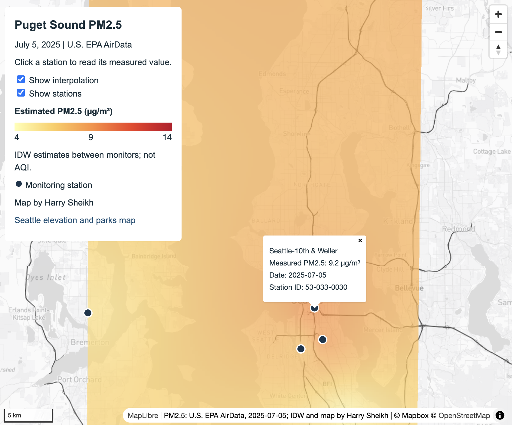
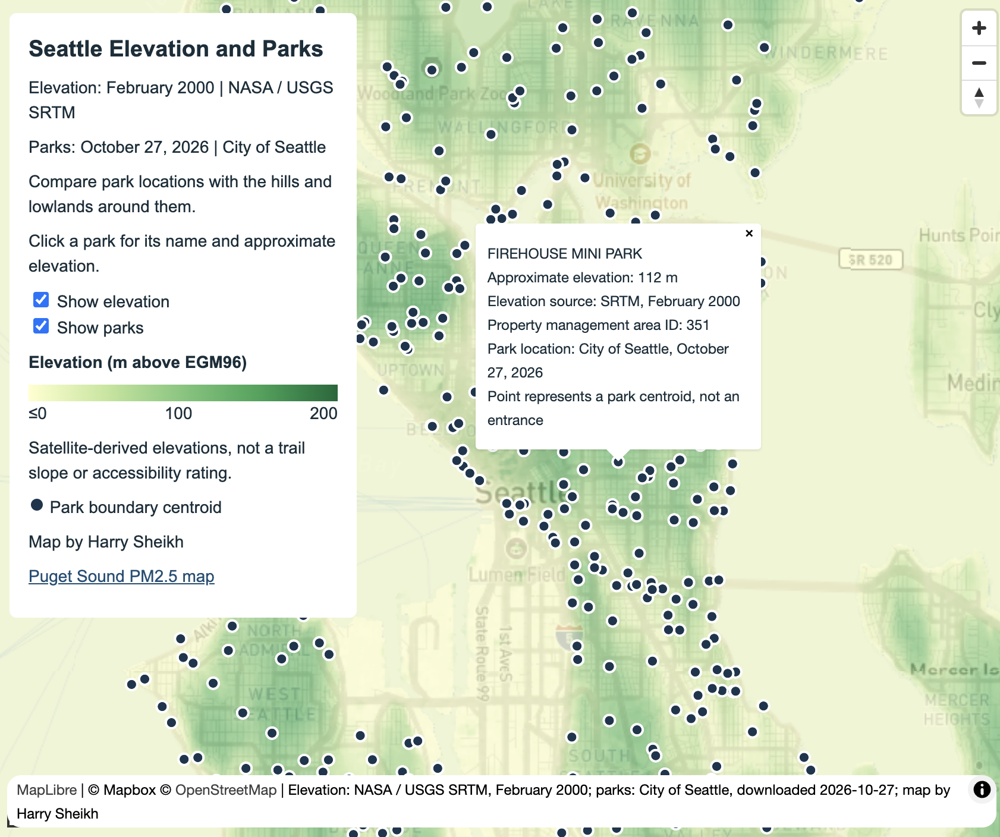

# Lab 3: Map Design and Tile Generation

Harry Sheikh | GEOG 458

## Puget Sound PM2.5

This map helps people compare air pollution across the Puget Sound.

The supplied [EPA AirData](https://aqs.epa.gov/aqsweb/airdata/download_files.html) sample has 11 monitoring stations from July 5, 2025. The points were projected to EPSG:32610, then interpolated in QGIS using IDW with a distance coefficient of 2 and a target cell size of 250 m. The surface uses a yellow-to-red ramp from 4 to 14 µg/m³.

Station popups show measured daily concentrations. The surface estimates values between stations; it does not represent measurements at every pixel.

The Mapbox Light basemap excludes five commercial POI classes (`commercial_services`, `store_like`, `food_and_drink`, `food_and_drink_stores`, and `lodging`) and uses `#404040` for freeways and `#d9d9d9` for other roads so the pollution colors stand out.

## Seattle elevation and parks

This map helps people planning park visits compare park locations with Seattle's hills and lowlands.

The [NASA / USGS SRTM](https://www.usgs.gov/centers/eros/science/usgs-eros-archive-digital-elevation-shuttle-radar-topography-mission-srtm) elevation data were collected in February 2000. The raster was cropped to Seattle without resampling, styled in QGIS with a green ramp from 0 to 200 m, and exported with transparent NoData areas. Park centers come from [City of Seattle data](https://services.arcgis.com/ZOyb2t4B0UYuYNYH/arcgis/rest/services/Park_Boundaries/FeatureServer/0) downloaded on October 27, 2026.

Park points carry elevations sampled from the same raster, so their popups and the map colors describe the same terrain. These are estimates from the nearest raster cell, not measurements taken at each park. The map pairs terrain from 2000 with park locations from 2026.

The Outdoors basemap uses pale land (`#f4f2ec`), blue water (`#cbdde5`), light green landcover (`#e2e8dc`), muted surface and bridge roads (`#b5b2ad`), and hillshade opacity 0.12 to keep the elevation overlay clear.

## Processing and export extent

The basemaps use customized Mapbox Light and Outdoors styles, with Mapbox and OpenStreetMap attribution. QMetaTiles exported each basemap and thematic raster separately as 256 × 256 PNG tiles in EPSG:3857, using XYZ numbering and zooms 8–12.

| Map | West | South | East | North |
| --- | --- | --- | --- | --- |
| PM2.5 | -122.75 | 47.10 | -122.05 | 48.15 |
| Elevation | -122.45 | 47.49 | -122.22 | 47.74 |

## Screenshots

